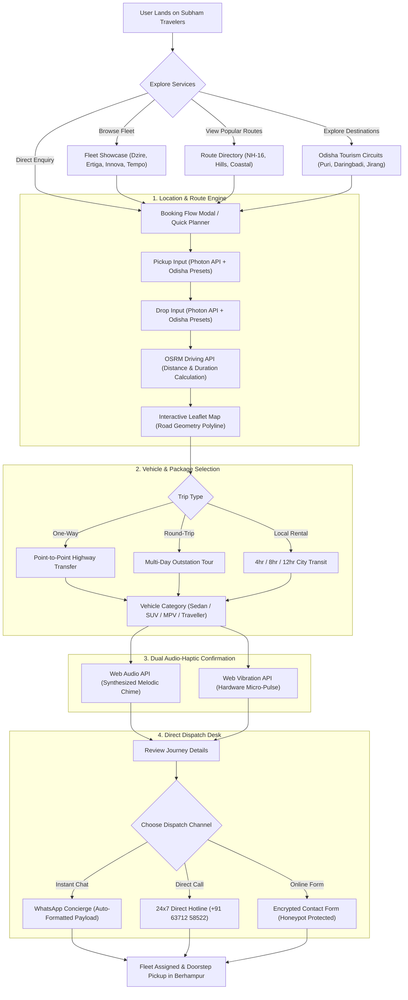
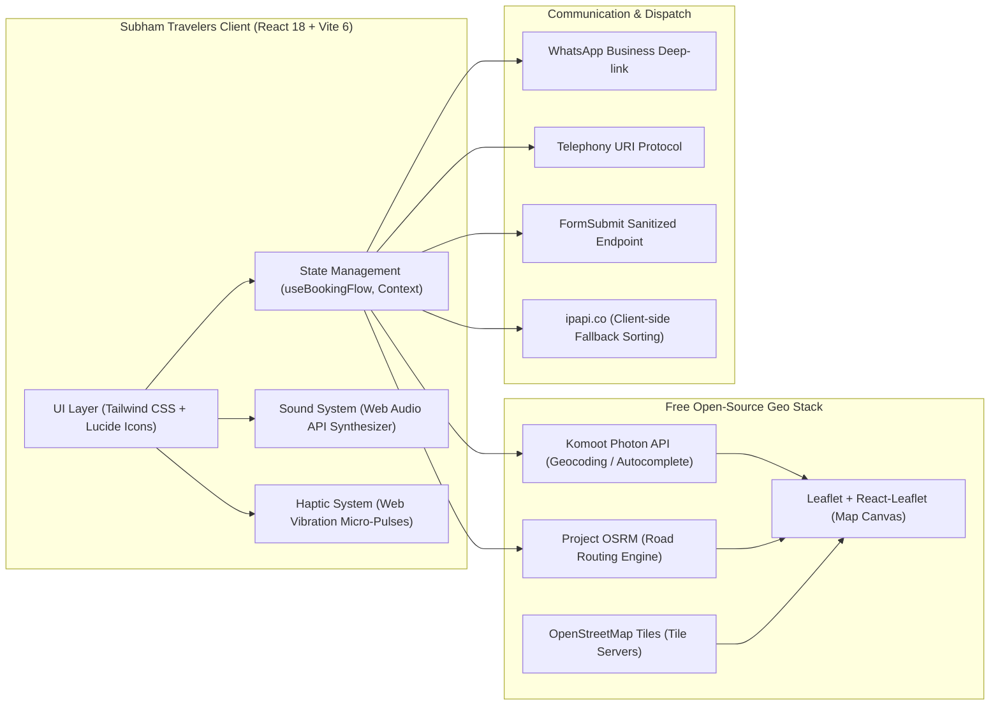
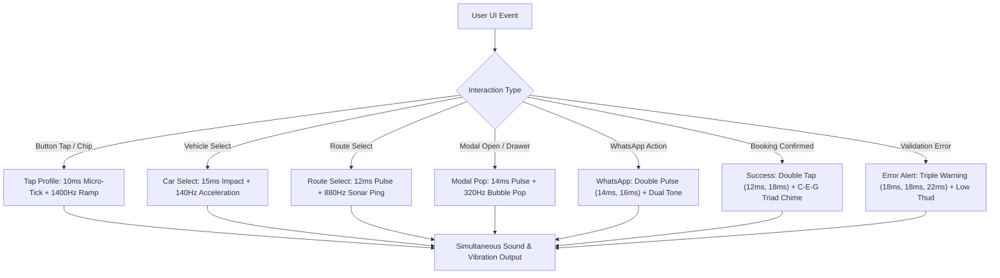

# Subham Travelers — Odisha Intercity Cabs & Tour Dispatch

> **Subham Travelers** is a premium cab reservation and intercity travel dispatch platform based in Berhampur (Silk City), Odisha. Built with **React 18**, **Vite 6**, **TypeScript**, **Tailwind CSS**, and an entirely free, open-source mapping stack (**Leaflet**, **OpenStreetMap**, **Photon Geocoding**, **OSRM Routing**), coupled with a custom Web Audio API synthesizer and mobile hardware haptic feedback engine.

---

## 📊 System Working Flow Diagrams

### 1. End-to-End Booking & Concierge Workflow



---

### 2. Technical Architecture & Data Flow



---

### 3. Tactile Audio-Haptic Interaction Matrix



---

## 🗺️ Free & Open-Source Mapping Stack

The application uses an entirely **free and open-source mapping stack** with zero dependency on Google Maps Platform:

1. **Map Rendering:** [Leaflet](https://leafletjs.com/) (`leaflet` + `react-leaflet`) with official OpenStreetMap tiles (`https://{s}.tile.openstreetmap.org/{z}/{x}/{y}.png`).
2. **Location Autocomplete:** [Photon API](https://photon.komoot.io/) by Komoot (OpenStreetMap-based geocoding, biased to Odisha/India coordinates with automatic preset fallback).
3. **Driving Route Calculation:** [OSRM (Open Source Routing Machine)](https://project-osrm.org/) road driving API (`https://router.project-osrm.org`).
4. **Animated Route Visualization:** Leaflet Polyline with progressive road route rendering and a moving directional vehicle indicator following actual road curvature.
5. **Distance & Duration Estimates:** Displays accurate road driving distance in kilometers and estimated driving hours with transparent toll/fuel inclusion and zero surge pricing.

---

## 🔊 Synthesized Audio & Hardware Haptic Engine

The platform features an integrated sensory interaction system:

- **20 Distinct Web Audio API Synthesized Profiles (`src/lib/sound.ts`):** Procedurally generated micro-sounds (no external audio assets to download, zero latency). Profiles include `playTap`, `playPop`, `playClose`, `playSuccess`, `playSwitch`, `playCarSelect`, `playRouteSelect`, `playTab`, `playWhatsApp`, `playCall`, `playCopy`, `playFilter`, `playAccordion`, `playInputFocus`, `playError`, `playClear`, `playHover`, `playBadge`, `playQuote`, and `playNotification`.
- **Mobile Hardware Haptics (`src/lib/haptics.ts`):** Contextual vibration patterns via the Web Vibration API (`navigator.vibrate`) with safety checks and throttling (20ms) to ensure a premium native mobile experience on Android and supported mobile browsers.
- **Zero-Latency Mobile Touch (`src/index.css`):** Configured with `touch-action: manipulation;` and `-webkit-tap-highlight-color: transparent;` to eliminate mobile 300ms double-tap delays.

---

## 🛣️ Odisha Regional Corridors Supported

Comprehensive coverage departing from Berhampur across all 30 districts of Odisha:

1. **Southern & Hill Corridors:**
   - **Berhampur ⇄ Bhubaneswar Airport (BBI)** (170 km, ~3.5 hrs) — NH-16 Express direct flight drop & pickup.
   - **Berhampur ⇄ Daringbadi Valley** (125 km, ~3.5 hrs) — "Kashmir of Odisha", Sorada Ghats, pine valleys, coffee gardens.
   - **Berhampur ⇄ Taptapani, Khasada & Jirang** (55 km, ~1.5 hrs) — Sulfur hot springs, waterfalls & Tibetan Monastery.
   - **Berhampur ⇄ Gopalpur-on-Sea** (16 km, ~30 mins) — Historic beach, lighthouse & coastal transit.
   - **Berhampur ⇄ Koraput / Jeypore / Rayagada** (320 km, ~7 hrs) — Eastern Ghats hill connectivity.

2. **Coastal Pilgrimage Corridors:**
   - **Berhampur ⇄ Puri Shree Jagannath Dham** (155 km, ~4 hrs) — Coastal Highway pilgrimage route.
   - **Berhampur ⇄ Konark Sun Temple & Marine Drive** (185 km, ~4.5 hrs) — UNESCO World Heritage circuit.
   - **Berhampur ⇄ Chilika Lake (Barkul / Rambha)** (45 km, ~1 hr) — Asia's largest brackish lagoon & boating.

3. **Western & Northern Expressways:**
   - **Berhampur ⇄ Cuttack / SCB Medical** (200 km, ~4 hrs) — Medical transit & silver city link.
   - **Berhampur ⇄ Sambalpur / Hirakud** (380 km, ~7.5 hrs) — Western Odisha industrial corridor.

---

## 🔒 Security & Privacy Implementation

- **No Hardcoded Fallback Emails:** Production builds strictly sanitize and protect business owner configurations.
- **FormSubmit Sanitization:** Contact submissions are protected with honeypot fields (`_gotcha`), cooldown rate-limiting, and telephone control-character injection stripping.
- **Vercel HTTP Security Headers:** Pre-configured `X-Frame-Options`, `X-Content-Type-Options`, `Referrer-Policy`, `Permissions-Policy`, `Strict-Transport-Security`, and Content Security Policy (`CSP`).
- **SPA Rewrite Configuration:** Clean Vercel routing rewrite rules (`/(.*)` -> `/index.html`) preventing 404 errors on direct subroute refreshes (`/fleet`, `/destinations`, `/routes`).

---

## 🚀 Getting Started

### Prerequisites

- **Node.js**: v18.0.0 or higher
- **npm**: v9.0.0 or higher

### 1. Installation

```bash
npm install
```

### 2. Environment Configuration

Copy the example environment configuration:

```bash
cp .env.example .env
```

| Variable | Description | Default Endpoint |
| :--- | :--- | :--- |
| `VITE_PHOTON_API_URL` | Photon Geocoding API | `https://photon.komoot.io/api` |
| `VITE_OSRM_API_URL` | OSRM Driving Routing API | `https://router.project-osrm.org` |
| `VITE_WHATSAPP_NUMBER` | Business WhatsApp (Country code + digits, no `+`) | `916371258522` |
| `VITE_SUPPORT_PHONE` | Direct phone support display string | `+91 63712 58522` |
| `VITE_SUPPORT_EMAIL` | Official enquiry email address | `contact@subhamtravelers.com` |
| `VITE_SITE_URL` | Canonical site URL | `http://localhost:5173` |

### 3. Run Development Server

```bash
npm run dev
```

The application will be accessible at: `http://localhost:5173/`

### 4. Build & Full Test Verification

```bash
# Run ESLint validation
npm run lint

# Compile TypeScript and bundle production assets
npm run build

# Run automated 23-check end-to-end service verification suite
node test-scripts/test-all-services.mjs
```

---

## 📁 Architecture & File Layout

```
src/
├── components/
│   ├── booking/
│   │   ├── BookingModal.tsx            # Multi-step booking flow with review & dispatch
│   │   └── TravelQuoteEstimator.tsx    # Fare estimation & vehicle options
│   ├── cards/
│   │   ├── DestinationCard.tsx         # Tourism card with 3-image collage & collision-proof badges
│   │   ├── RouteCard.tsx               # Corridor cards with distance & duration
│   │   └── VehicleCard.tsx             # Fleet category specifications & pricing
│   ├── home/
│   │   ├── HeroSection.tsx             # Interactive hero banner & vehicle switcher
│   │   ├── HeroDispatchShowcase.tsx    # Live dispatch visualizer
│   │   ├── MetricsBand.tsx             # 24x7 dispatch stats & highway corridors
│   │   ├── FloatingContactWidget.tsx   # Direct WhatsApp / Phone quick drawer
│   │   └── QuickJourneyPlanner.tsx     # Fast corridor planner
│   ├── maps/
│   │   ├── LocationAutocomplete.tsx    # Search input with Photon & Odisha presets
│   │   ├── RouteMap.tsx                # Interactive Leaflet map & animated vehicle marker
│   │   └── RouteSummary.tsx            # Road distance and driving duration display
│   └── ui/
│       ├── Button.tsx                  # Tactile button with sound & haptic integration
│       └── Card.tsx                    # Elevated glass & solid card containers
├── data/
│   ├── brandConfig.ts                  # Brand metadata, routes, phones & navigation
│   ├── destinations.ts                 # Odisha destinations data with collage assets
│   ├── odishaPlaces.ts                 # Preset Odisha geographic locations & coordinates
│   └── routes.ts                       # Curated intercity corridors & timings
├── lib/
│   ├── haptics.ts                      # Web Vibration API tactile micro-pulse engine
│   ├── sound.ts                        # Web Audio API 20-tone synthesized sound system
│   ├── contactUtils.ts                 # WhatsApp URL & phone link generators
│   └── utils.ts                        # Class name utility (cn)
├── pages/
│   ├── Home.tsx                        # Main landing portal
│   ├── Fleet.tsx                       # Vehicle showroom & specifications
│   ├── Destinations.tsx                # Curated Odisha tourism circuits
│   ├── Routes.tsx                      # Fixed-fare highway corridor directory
│   ├── About.tsx                       # Company narrative & chauffeur standards
│   ├── Contact.tsx                     # 24x7 Berhampur operations desk
│   └── Feedback.tsx                    # Customer ratings & reviews submission
└── test-scripts/
    └── test-all-services.mjs           # 23-check automated test verification suite
```

---

## 📄 License

Proprietary © Subham Travelers. All rights reserved.
